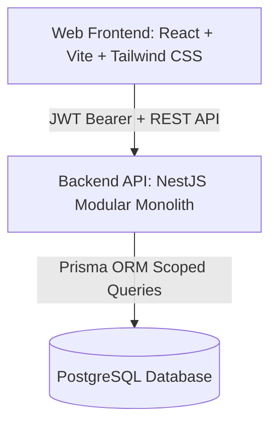
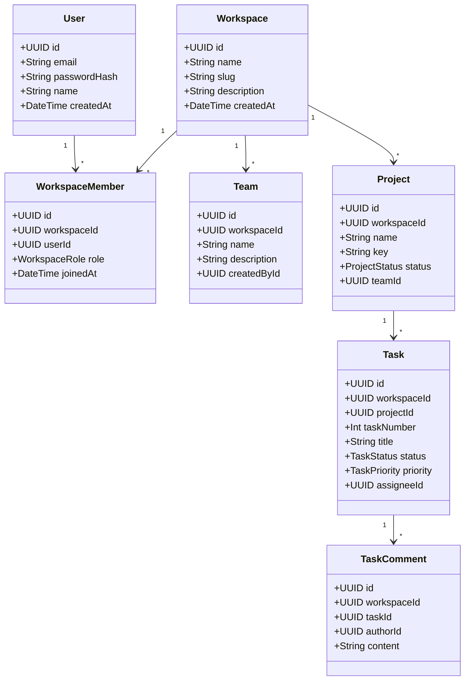

# Team OS — Architecture Specification

## 1. System Overview

Team OS is a multi-tenant project management and collaboration platform engineered to serve as the foundational operating system for modern teams.
Milestone 1 establishes the core workspace, membership, team, project, task, comment, and dashboard infrastructure with strict tenant isolation, role-based access control (RBAC), and relational integrity.



---

## 2. Multi-Tenant Architecture & Isolation Model

### 2.1 Workspace as Tenant Boundary
A `Workspace` represents an isolated organizational domain. All operational entities (`Team`, `Project`, `Task`, `TaskComment`, `WorkspaceMember`) are strictly owned by a `workspaceId`.

### 2.2 Tenant Isolation Principles
1. **Never Trust Client Workspace Assertions**: The client includes `:workspaceId` in route parameters. The NestJS `WorkspaceAuthGuard` intercepts every workspace-scoped route, verifies that the authenticated user (`req.user.id`) has an active `WorkspaceMember` record for that specific `workspaceId`, and attaches the membership and role to `req.workspaceMember`.
2. **Compound Filtering on All Tenant Queries**: Every database query on tenant resources must explicitly filter by `workspaceId: req.workspaceMember.workspaceId` in addition to resource IDs (e.g., `where: { id: taskId, workspaceId }`).
3. **Cross-Workspace Access Prevention**: Any request attempting to access or modify a resource belonging to a different workspace yields an HTTP 403 Forbidden or 404 Not Found without leaking existence.
4. **Member Validation for Assignments**: Tasks can only be assigned to users who are confirmed active members of the same workspace. Projects can only be assigned to teams within the same workspace.

---

## 3. Role-Based Access Control (RBAC)

Each `WorkspaceMember` has an assigned role within that workspace:
- **`OWNER`**: Creator or designated owner. Full access to workspace settings, member management (add, promote, demote, remove), teams, projects, tasks, and comments. The last owner cannot be removed or demoted.
- **`ADMIN`**: Management privileges. Can invite members, promote/demote members (cannot alter owner), manage teams, create/edit/archive projects, manage tasks and comments. Cannot remove or demote OWNER.
- **`MEMBER`**: Operational collaborator. Can view projects and teams, create and edit tasks in active projects, assign tasks to workspace members, post/edit their own comments. Cannot manage members, edit workspace settings, delete teams, or archive projects. Cannot edit tasks in archived projects.



---

## 4. Backend Module Structure (NestJS)

```
apps/api/src/
├── auth/                 # Authentication (register, login, refresh, logout, profile)
├── common/               # Guards (JwtAuthGuard, WorkspaceAuthGuard, RolesGuard), decorators, filters
├── dashboard/            # Aggregated statistics, personal tasks, overdue work
├── prisma/               # Prisma service and repository bindings
├── projects/             # Project CRUD, keys, progress calculation, archiving
├── tasks/                # Task CRUD, status, priorities, assignments, board ordering
├── task-comments/        # Task comments CRUD, permissions, author validation
├── teams/                # Team CRUD, membership assignment
├── workspace-members/    # Member listing, invitations (existing users), role changes, removal
└── workspaces/           # Workspace CRUD, switching, settings
```

---

## 5. Technology Stack Summary

- **Frontend**: React 18 / 19, TypeScript, Vite, Tailwind CSS, React Router v6, TanStack Query, React Hook Form, Zod, Lucide React, dnd-kit.
- **Backend**: Node.js, TypeScript, NestJS, Prisma ORM, class-validator, class-transformer, passport-jwt, bcrypt, Swagger/OpenAPI.
- **Database**: PostgreSQL (local service or Docker Compose), indexed relational schema.
- **Testing**: Jest & Supertest (backend unit & integration), Vitest & Testing Library (frontend), Playwright (E2E).

