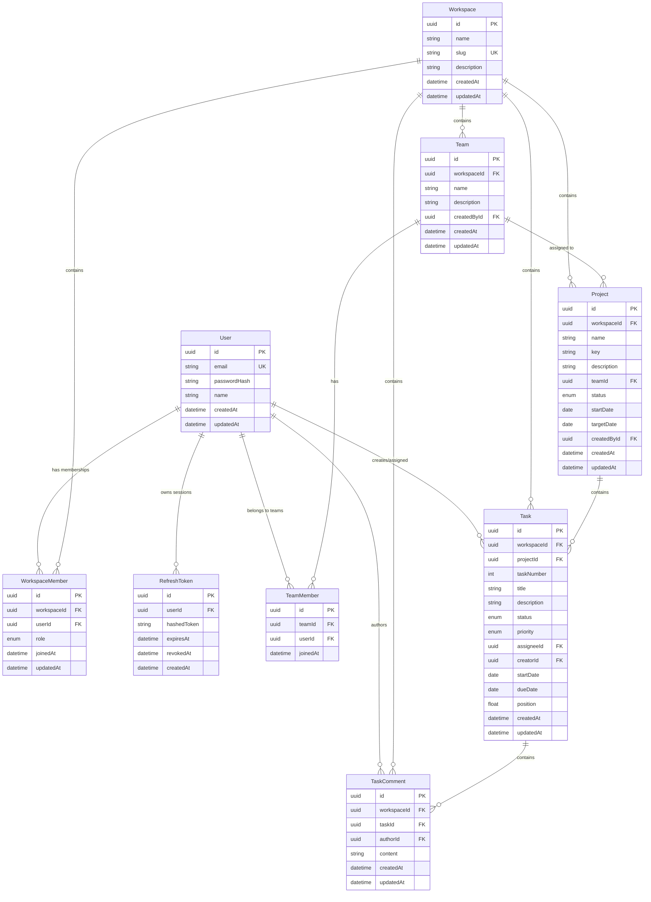

# Team OS — Database Schema Specification

## 1. Relational Entity-Relationship Diagram

---

## 2. Enums and Controlled Fields

### `WorkspaceRole`
- `OWNER`
- `ADMIN`
- `MEMBER`

### `ProjectStatus`
- `ACTIVE`
- `ARCHIVED`

### `TaskStatus`
- `BACKLOG`
- `TODO`
- `IN_PROGRESS`
- `IN_REVIEW`
- `BLOCKED`
- `DONE`

### `TaskPriority`
- `LOW`
- `MEDIUM`
- `HIGH`
- `URGENT`

---

## 3. Relational Constraints & Indexes

1. **Unique Constraints**:
   - `User.email` (unique, lowercase)
   - `Workspace.slug` (unique)
   - `WorkspaceMember(workspaceId, userId)` (composite unique)
   - `TeamMember(teamId, userId)` (composite unique)
   - `Project(workspaceId, key)` (composite unique: project key unique within workspace)
   - `Task(projectId, taskNumber)` (composite unique: incremental task number per project)

2. **Indexes for Performance & Isolation**:
   - `WorkspaceMember(workspaceId, userId)`
   - `Project(workspaceId, status)`
   - `Task(workspaceId, projectId, status)`
   - `Task(workspaceId, assigneeId)`
   - `Task(workspaceId, dueDate)`
   - `TaskComment(workspaceId, taskId, createdAt)`
   - `Team(workspaceId)`

3. **Cascade & Integrity Rules**:
   - `WorkspaceMember`: `onDelete: Cascade` when Workspace is deleted; `onDelete: Cascade` when User is deleted.
   - `Team`: `onDelete: Cascade` when Workspace is deleted.
   - `TeamMember`: `onDelete: Cascade` when Team is deleted.
   - `Project`: `onDelete: Cascade` when Workspace is deleted. Project does NOT delete team. If team is deleted, `Project.teamId` becomes `SetNull`.
   - `Task`: `onDelete: Cascade` when Project is deleted. If assignee is removed from workspace, `assigneeId` is set to null or preserved historically without losing task.
   - `TaskComment`: `onDelete: Cascade` when Task is deleted.

